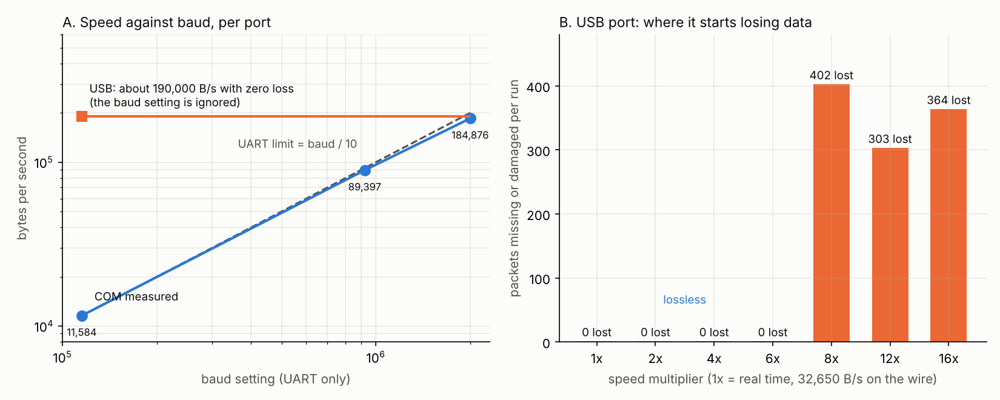
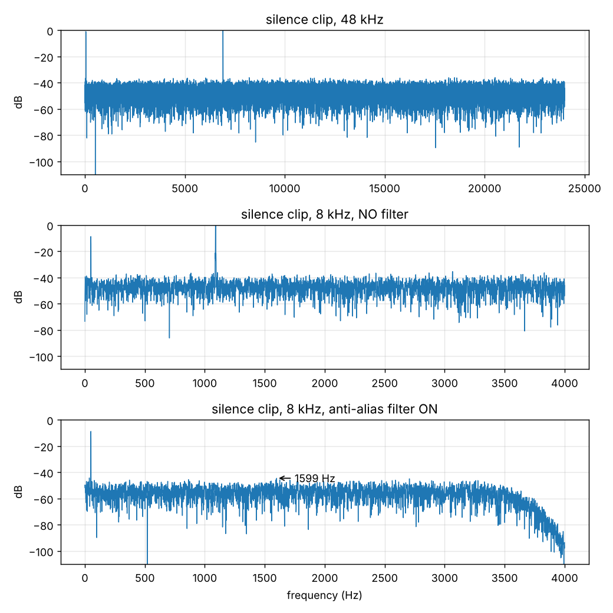

**Status.** All board measurements for Missions 1 and 2 were taken on team 6's board on 24 November 2026 and are filled in below. The sections marked **[YOUR WORDS]** (what we learnt, the first LLM question, the team reflection) must be written by the team in their own words.

# Mission 1 — The pipe (data rate and data type)

## 1. Aim
Find how many bytes per second really reach the board on each USB port, what the data type (float32, int16, int8) does to the load, and what the packet size costs.

## 2. Background
- A UART sends 10 bits for every byte (1 start bit, 8 data bits, 1 stop bit). So a baud rate divided by 10 is the most bytes per second it can carry.
- The **COM** port goes through a USB-to-UART bridge chip, so the baud rate is a real speed limit. The **USB** port is the ESP32-S3's own USB (USB CDC). It is a virtual serial port, so the baud setting means nothing to it; its limit is USB full speed (12 Mbit/s) and how fast the board's code can read.
- Every frame carries 13 bytes of extra data: 2 magic bytes, 1 type, 4 sequence, 2 length, 4 CRC.
- `pyserial`'s `write()` can return before the bytes have left the laptop, so speed is timed over the whole stream call, until the board's summary comes back, not just over the writes.

## 3. Prediction (written before measuring)
| Audio | Bytes per second |
|---|---|
| 16 kHz float32 | 64,000 |
| 16 kHz int16 | 32,000 |
| 16 kHz int8 | 16,000 |
| 8 kHz int16 | 16,000 |
| 8 kHz int8 | 8,000 |

- 115,200 baud UART: 115,200 / 10 = **11,520 bytes per second** at best. 921,600 baud: 92,160. 2,000,000 baud: 200,000.
- **COM port** speed should track baud/10 at 115,200 and 921,600, and flatten near the bridge chip's or the board's own limit at 2,000,000.
- **USB port** speed should not change with baud and should be much higher than COM at 921,600 (prediction: several hundred kB/s).
- Packet size: with 16 kHz int16, `samples_per_packet` 8 / 64 / 320 / 1024 gives 29 / 141 / 653 / 2,061 bytes per packet, so framing overhead of 44.8% / 9.2% / 2.0% / 0.6%.
- Features coming back (win 480, hop 320, 40 mel, 16 kHz): 50 frames per second × 181 bytes = **9,050 bytes per second** (9 header + 8 + 160 feature bytes + 4 CRC per frame).

## 4. Method
`m1_pipe.py` streams real team-6 audio with `feat=False, store="none"`. Each setting is run 4 times and run 0 is treated as warm-up (first runs are slower). Results go to `m1_results.csv`.
```
python m1_pipe.py com  --port <COM port>        # speed=0 at 115200, 921600, 2000000 baud
python m1_pipe.py usb  --port <USB port>        # speed=0
python m1_pipe.py plot                          # speed vs baud
python m1_pipe.py realtime --port <p> --label com --baud 921600   # speed=1, five format/rate rows (repeat for each port/baud)
python m1_pipe.py packets  --port <p> --label usb                 # samples_per_packet sweep
```

## 5. Observations

**Table 1: speed=0, 16 kHz int16, 320 samples per packet (bytes per second on the wire, mean of runs 1 to 3; run 0 is the warm-up)**

| Port | Baud | Predicted limit | Measured | Share of limit |
|---|---|---|---|---|
| COM | 115,200 | 11,520 | **11,584** | 100.6% |
| COM | 921,600 | 92,160 | **89,397** | 97.0% |
| COM | 2,000,000 | 200,000 | **184,876** | 92.4% |
| USB | (ignored) | not a UART | **190,394** with zero loss (see below) | |

No packet was lost or damaged on the COM port in any run (`gaps=0, crc=0, uart_errors=0`).

{ width=95% }

**The USB port at "as fast as possible" (speed=0) lost data.** Four runs: the laptop wrote at 83,000 to 366,000 B/s, but the board reported 163 to 189 damaged packets (bad CRC) in every run, and in two runs 426 to 434 missing packets, while in the other two the board stopped receiving after about 0.27 s. So the laptop's number was how fast it *wrote*, not how fast the board *kept* the data. To find the real USB speed, we repeated the stream at speed 1, 2, 4, 6, 8, 12 and 16 times real time (4 runs each):

| Speed | Wire rate needed (B/s) | Laptop sent (B/s) | Missing + damaged packets |
|---|---|---|---|
| 1x | 32,650 | 32,497 | 0 |
| 2x | 65,300 | 64,698 | 0 |
| 4x | 130,600 | 128,146 | 0 |
| 6x | 195,900 | 190,394 | 0 |
| 8x | 261,200 | 233,459 | about 270 missing + 135 damaged per run |
| 12x | 391,800 | stalled | 188 to 627 per run |
| 16x | 522,400 | stalled | 171 to 629 per run |

So **USB is lossless up to about 190,000 B/s (6x real time) and loses data from 8x (about 233,000 B/s offered)**. The COM port at 2,000,000 baud was also lossless at about 185,000 B/s.

**Table 2: can each port carry the stream at speed=1 (5 s of sound, no gaps, no bad CRC, sent in about 5 s)?** Needed = wire rate with 13 bytes of framing per 320-sample packet. Time shown is how long it took to send 5 s of sound.

| Stream | Needed (B/s) | COM 115,200 | COM 921,600 | COM 2,000,000 | USB |
|---|---|---|---|---|---|
| 16 kHz f32 | 64,650 | **no** (27.9 s) | yes (5.02 s) | yes (5.01 s) | yes (5.00 s) |
| 16 kHz i16 | 32,650 | **no** (14.1 s) | yes (5.01 s) | yes (5.01 s) | yes (5.00 s) |
| 16 kHz i8 | 16,650 | **no** (7.2 s) | yes (5.00 s) | yes (5.00 s) | yes (5.00 s) |
| 8 kHz i16 | 16,325 | **no** (7.1 s) | yes (5.01 s) | yes (5.00 s) | yes (5.00 s) |
| 8 kHz i8 | 8,325 | **yes** (5.03 s) | yes (5.00 s) | yes (5.00 s) | yes (5.00 s) |

Every answer matched the prediction. At 115,200 baud the four heavier streams were simply sent at the port's limit (about 11,500 B/s), so 5 s of sound took 7 to 28 s.

**Table 3: samples per packet, COM at 921,600 baud, 16 kHz int16, speed=0 (mean of 4 runs)**

| Samples per packet | Packets in 10 s | Header overhead | Useful audio rate (B/s) | Predicted maximum (B/s) |
|---|---|---|---|---|
| 8 | 20,000 | 44.8% | 51,227 | 50,847 |
| 64 | 2,500 | 9.2% | 84,129 | 83,663 |
| 320 | 500 | 2.0% | 88,725 | 90,325 |
| 1,024 | 157 | 0.6% | 91,437 | 91,579 |

The predicted maximum is 92,160 x payload / (payload + 13). The measured values follow it within 2% in every row.

**Features coming back:** 9,050 bytes per second at 16 kHz, hop 320, 40 mel (50 frames per second, 181 bytes each). This travels in the other direction, so it uses the board's transmit side while the audio uses its receive side (UART is full duplex). At 115,200 baud it would take 79% of that direction's capacity.

## 6. Analysis
- **The two ports are different kinds of port.** The COM socket goes through a USB-to-UART chip (the CH343 on this board), so the baud setting is a real speed limit: the measured speed was 100.6%, 97.0% and 92.4% of baud/10 at 115,200, 921,600 and 2,000,000 baud. The USB socket has no baud rate (it is a virtual serial port), and its speed was not set by any baud setting.
- **Measured slightly above the limit at 115,200 (100.6%).** A byte cannot take less than 10 bit-times, so this is probably a small error in the chip's baud clock (under 1%). We did not test this.
- **Why the COM port falls a little short at higher baud (97%, 92%).** Probably the laptop, the USB bridge and the board's own reading take a growing share of the time as the wire gets faster. We did not test this either.
- **USB lost data when pushed hard even though USB itself is fast.** At speed=0 the laptop offered up to about 366,000 B/s, but the board only kept data cleanly up to about 190,000 B/s; above that, bytes were dropped and checksums failed. The COM port at 2,000,000 baud topped out at about the same figure (185,000 B/s) with no loss. Our hypothesis: the board's program cannot read incoming bytes faster than about 200,000 B/s, so the board, not the cable, is the limit, and when data arrives faster the receive buffer overflows and bytes are dropped. This is exactly what the sequence numbers and CRCs catch in Mission 4; we have not yet tested the hypothesis directly.
- **A speed number is only valid if nothing was lost.** The "366,301 B/s" USB figure is how fast the laptop wrote, not how fast the board kept data, so we report the zero-loss figure (190,394 B/s) instead.
- **Small packets cost bandwidth, not extra work.** At 8 samples per packet, 44.8% of the bytes on the wire are headers, so the useful audio rate fell from about 91,000 to 51,000 B/s. The measured values match the arithmetic (within 2%), so at this speed we saw no sign of extra per-packet work by the board.
- **The data type sets the load by its byte width.** int16 is half of float32, int8 is half of int16. Halving the sample rate also halves the bytes, but it changes what the model can hear (Mission 2).
- **For our chosen stream** (16 kHz int16, 32,650 B/s on the wire): COM at 921,600 baud has a margin of 89,397 / 32,650 = **2.7x**, and USB has a zero-loss margin of 190,394 / 32,650 = **5.8x**. At 115,200 baud it cannot be carried in real time (needs 2.8x the port's capacity).

## 7. What we learnt
**[YOUR WORDS: three sentences using the numbers above. Points you can build on: the COM speed follows baud/10; the USB socket has no baud rate but lost data above about 190,000 B/s; a speed measured with losses is not a real speed; small packets waste bandwidth on headers.]**

## 8. LLM log
- **[YOUR WORDS: the question the assignment asked you to put to an LLM before Mission 1 ("how many bytes per second can you send to an ESP32-S3 over USB?"): what it answered, and whether our measurement (USB lossless to about 190,000 B/s; COM 184,876 B/s at 2,000,000 baud) agreed.]**
- An LLM (Claude) wrote the first versions of `m1_pipe.py`, `quant.py`, `m2_analysis.py` and `m2_storage.py`, and explained each step of setting up and running them. We ran every command on our own board and pasted the outputs back.
- Testing on our board found two problems with the LLM's script: it could not reconnect to the board after a baud-rate change (fixed: it now tries several baud rates), and the USB speed test reported a laptop write speed while the board was losing data (fixed: a new `sweep` test finds the fastest zero-loss speed).

\newpage

# Mission 2 — What to send, and where to keep it

## 1. Aim
Choose the sampling rate, number format and scale; see what goes wrong if they are wrong; and keep the whole recording on the board so that it survives a power cut.

## 2. Background
- Quantisation (from the handout): `q = clip(round(x/S·(2^(b−1)−1)), −2^(b−1), 2^(b−1)−1)` and `x̂ = q·S/(2^(b−1)−1)`. A sample of size S becomes the biggest code; anything larger is clipped. Code: `quant.py` (`quantise`, `dequantise`, `pack`, `unpack`; the self-test checks that bytes survive pack then unpack exactly).
- A tone at frequency f sampled at fs appears at its distance from the nearest whole multiple of fs. That is aliasing.
- SQNR = 10·log10(signal power / error power). Each extra bit adds about 6 dB.
- N16R8 means 16 MB flash and 8 MB **octal** (OPI) PSRAM.

## 3. Prediction
- Team 6's room (read from `team_audio.py`): regulator whine at **6,909.92 Hz**, whine amplitude 0.047, hum 50 Hz, room noise 0.0053.
- At 48 kHz the whine appears at 6,909.92 Hz. At 8 kHz with no filter it folds to |6,909.92 − 8,000| = **1,090.08 Hz**, which is inside the speech band.
- int16 should beat int8 by about 48 dB (8 bits × 6 dB). A quiet clip should have a lower SQNR than a loud one at the same S, because it uses fewer codes.
- Storage for all 144 clips (144 s): 16 kHz float32 9.216 MB, int16 4.608 MB, int8 2.304 MB; 8 kHz int16 2.304 MB, int8 1.152 MB.
- PSRAM is 8 MB, so 16 kHz float32 (9.216 MB) cannot fit and int16 (4.608 MB) can.
- Internal SRAM: the module's spec gives roughly 300 KB free for a program, so at most about 9.4 s of 16 kHz int16 (300,000 / 32,000), probably less.

## 4. Method
`m2_analysis.py` (no board) produced the spectra, SQNR table and sizes. `m2_storage.py` runs the board experiments (`info`, `sram`, `psram`, `send`, `check`).

## 5. Observations

**Aliasing (silence clip, team 6; `figs/m2_aliasing.png`)**

| Setting | Biggest peak above 200 Hz |
|---|---|
| 48 kHz | 6,910 Hz, +12.4 dB |
| 8 kHz, no filter | **1,090 Hz**, +4.6 dB (the whine, folded) |
| 8 kHz, anti-alias filter on | no peak; the strongest component is −44.5 dB, about 49 dB below the alias |

{ width=75% }

The calculation 6,909.92 → 1,090.08 Hz matches the spectrum (1,090.0 Hz). The filter must come **before** sampling because once the whine has folded to 1,090 Hz it is indistinguishable from a real 1,090 Hz sound; no later processing can tell them apart. The anti-alias filter in `team_audio.py` is a 255-tap low-pass at 0.45 × the output rate (3.6 kHz at 8 kHz), which removes the 6.9 kHz whine before the samples are dropped.

**SQNR at 16 kHz, filter on (dB)**

| Clip | int16, S=1 | int8, S=1 | int8, S=0.5 | int8, S=0.25 | int8, S=0.1 |
|---|---|---|---|---|---|
| word "on" (peak 0.463) | 78.0 | 29.8 | 35.9 | 18.2 (1.5% clipped) | 6.7 (10.1% clipped) |
| silence (peak 0.065) | 71.3 | 23.1 | 29.2 | 35.1 | 43.1 |

Over all 144 clips (largest sample anywhere: 0.738):

| Format, S | Mean SQNR | Worst clip | Clipped samples |
|---|---|---|---|
| int16, 1.0 | 76.5 dB | 71.3 dB | 0% |
| int8, 1.0 | 28.3 dB | 23.1 dB | 0% |
| int8, 0.5 | 30.8 dB | 21.1 dB | 0.109% |
| int8, 0.35 | 24.6 dB | 12.9 dB | 0.598% |
| int8, 0.25 | 18.3 dB | 8.6 dB | 1.47% |

**Where the recording can live (measured on our board)**

| Place | Size | Fits 144 clips at 16 kHz int16 (4,608,000 B)? |
|---|---|---|
| Internal SRAM | largest free block 233,460 B; the board accepted a store of **233,380 B** = 7.29 s of 16 kHz int16 (3.65 s float32, 14.59 s int8) | **No** (7.29 s of 144 s) |
| PSRAM (OPI) | 8,388,608 B (`psram_size`), largest block 8,257,524 B | **Yes** for int16 (4.608 MB), int8 (2.304 MB) and 8 kHz int16 (2.304 MB); **no** for float32 (9.216 MB: `ERR alloc psram want=9216000 largest=8257524`) |
| Flash (file system) | `flash_chip` 16,777,216 B; `fs_total` **10,354,688 B** | **Yes**, with 5,726,208 B left after saving (`fs_used` 4,628,480) |

For SRAM, the test reserved the full 233,380 bytes (accepted by the board) and then filled half of it (116,690 B); the board's CRC32 and the laptop's matched (`790706d7`).

**Tools settings used** (from the start; we did not first run the board with the defaults, so what the defaults would have done is read from the Arduino files, not measured)
- Flash Size: **16MB (128Mb)**. The Arduino default for this board is 4 MB.
- Partition Scheme: **"16M Flash (3MB APP/9.9MB FATFS)"**. Its data partition is 0x9E0000 = 10,354,688 bytes, which is exactly the `fs_total` we measured. The default scheme only has about 1.5 MB for files, which cannot hold 4.6 MB. These 16 MB schemes name the partition `ffat`, not `spiffs`, so the sketch mounts LittleFS by that label (it tries `spiffs` first, then `ffat`).
- PSRAM: **OPI PSRAM** (the N16R8's PSRAM is octal). `psram_size` = 8,388,608 confirms it works.
- USB CDC On Boot: Enabled; Upload Mode: UART0 / Hardware CDC (uploaded through the COM socket); everything else left at its default (Flash Mode QIO 80 MHz, CPU 240 MHz, USB Mode Hardware CDC and JTAG).

**Power-cut test (sent over COM at 921,600 baud)**

| Item | Result |
|---|---|
| Recording | all 144 clips, 16 kHz, filter on, int16, S = 1.0: 4,608,000 bytes |
| CRC32 on the laptop | `f702a9e3` |
| Streaming time, board's summary | 51.7 s (89,000 B/s); `frames_ok` 7,201, `bad_crc` 0, `seq_gaps` 0, `store_full` 0 |
| PSRAM CRC before saving | `f702a9e3`, n = 4,608,000 |
| `SAVE` reply | `OK n=4608000 us=10208845 crc=f702a9e3` (10.2 s to write flash) |
| Flash CRC after saving | `f702a9e3` |
| After unplugging and replugging: PSRAM | n = 0 (the RAM copy did not survive) |
| After unplugging and replugging: flash | n = 4,608,000, CRC `f702a9e3`; `dump("flash")` identical to what was sent: **True** |

The code: `cmdSave()` in `doorbell_board_starter.ino` checks that something is stored and that the file system has room, removes any old `/rec.bin`, writes in 4 KB chunks checking every write, closes the file, deletes a half-written file on failure, and replies `OK SAVE n= us= crc=`.

## 6. Analysis
- **Rate.** 8 kHz without a filter folds team 6's whine into the speech band at 1,090 Hz, so it must be filtered. With the filter, 8 kHz keeps nothing above 3.6 kHz, which loses the consonant detail ("s", "t") that helps tell "stop" and "go" apart. 16 kHz with the filter keeps the whine at 6.9 kHz as a visible component (the filter edge is 7.2 kHz), which is harmless because it is a steady tone the model can learn to ignore.
- **Format.** int16 is about 48 dB cleaner than int8 (76.5 vs 28.3 dB), as predicted by 6 dB per bit. The worst case is always the quiet clip: silence gives 71.3 dB at int16 and 23.1 dB at int8, because quiet signals use only a few codes. int8 at 16 kHz is the same load as int16 at 8 kHz (16,000 B/s); 8 kHz int16 loses bandwidth but keeps 76 dB, while 16 kHz int8 keeps bandwidth but adds noise that sits under the quiet bands.
- **Scale.** The loudest sample in any of our 144 clips is 0.738. Making S smaller helps quiet clips but clips loud ones: int8 with S = 0.5 improves the mean by 2.5 dB but clips 0.109% of samples and the worst clip drops to 21.1 dB. For int16 there is nothing to gain from a smaller S. The doorbell has to pick S **before hearing anything**, so a data-dependent S (like 0.74) is not available to it: a fixed S equal to the microphone's full scale (1.0) is the only choice that can never clip.
- **Choice: 16 kHz, filter on, int16, S = 1.0.** Payload 32,000 B/s (32,650 on the wire); whole recording 4.608 MB, which fits in PSRAM (8 MB) and in flash (10.35 MB file system), but not in SRAM (7.29 s). Mission 1 shows this stream is carried in real time by COM at 921,600 baud (2.7x margin) and by USB (5.8x zero-loss margin). The fallback, if a port proved too slow, would be 8 kHz int16 or 16 kHz int8 (about 16,300 B/s on the wire), with the trade-offs above.
- **Storage.** SRAM is too small, PSRAM holds the recording but forgets it at power-off (n = 0 after replug), and flash keeps it (identical bytes, same CRC). That is why PSRAM is the working copy and flash is the saved copy. Float32 is out of the question: 9.216 MB does not fit in 8 MB of PSRAM.

## 7. What we learnt
**[YOUR WORDS: three sentences. Points you can build on: the filter must come before sampling or the whine folds to 1,090 Hz; int16 is about 48 dB cleaner than int8; SRAM holds only 7.29 s while PSRAM and flash hold all 144 s; PSRAM forgot the recording after the power cut and flash kept it.]**

## 8. LLM log
- **[YOUR WORDS: anything else you asked an LLM about Mission 2 and what you tested yourselves.]**
- An LLM (Claude) wrote `quant.py` (quantise, pack, unpack), `m2_analysis.py` (spectra, SQNR, storage sizes), `m2_storage.py` (board storage tests) and the `cmdSave()` function and file-system mounting change in the sketch, and explained the choice of Tools settings. We uploaded the sketch and ran every test on our own board; the numbers above are from our board. Everyone in the team must be able to explain every line before submitting.
