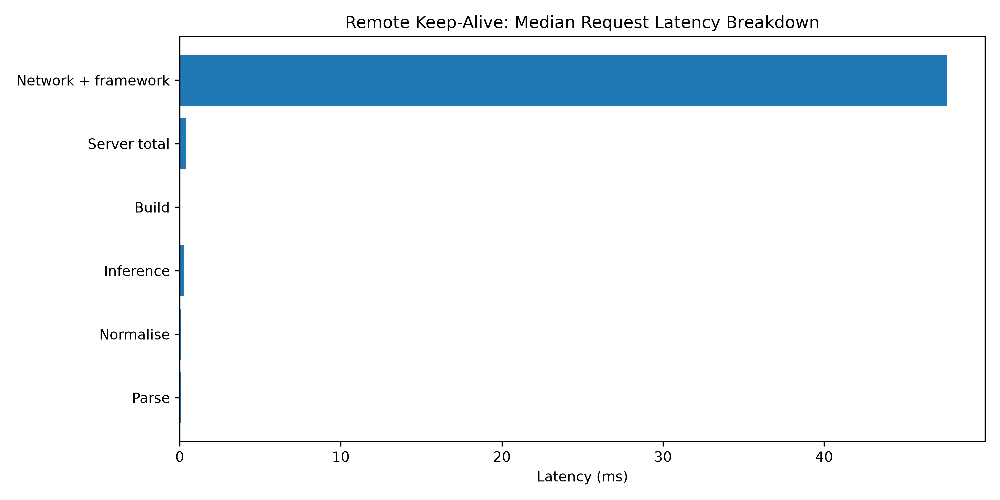
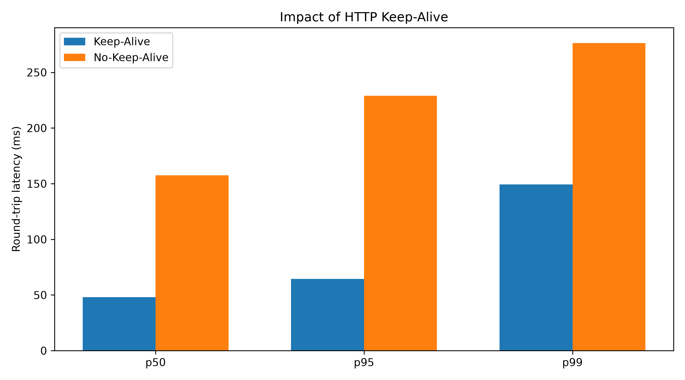
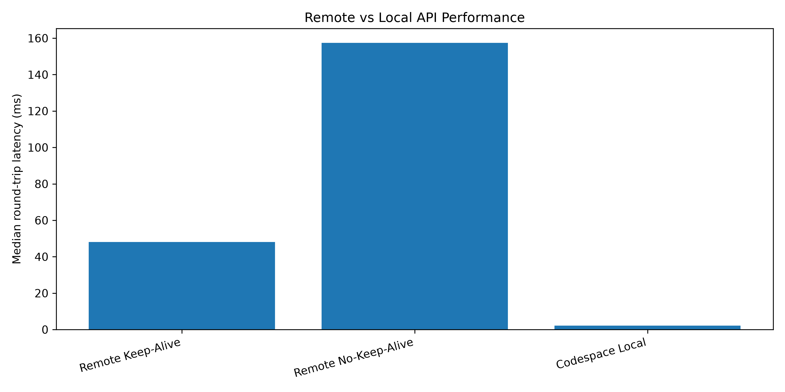
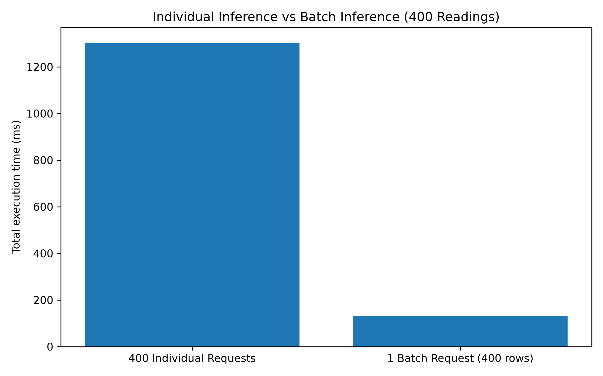

# Mission 3: Serve It and Time Every Stage

## 1. Objective

The objective of this mission was to deploy the battery-life prediction model through an API, validate incoming sensor readings, measure latency at different stages of the prediction pipeline, and compare remote, local, connection-reuse, and batch inference performance.

## 2. Initial Hypothesis

Before benchmarking, we expected the following:

- Network round-trip time would be the dominant latency for remote requests.
- Parsing and framework overhead would contribute some additional delay.
- Input normalisation would be relatively fast.
- Neural network inference would be lightweight because the model has only 1,281 parameters.

The experiments were conducted to verify this hypothesis.

## 3. Sensor Input Validation

Input validation was implemented in `app/main.py` using Pydantic field constraints.

The ranges were selected based on plausible physical sensor readings rather than the minimum and maximum values observed in the training dataset.

| Sensor/Input | Accepted range | Reason |
|---|---|---|
| battery_v | 2.5–4.5 V | Plausible battery voltage range |
| temp_c | −55–125 °C | DS18B20 operating range |
| rings_per_day | 0–200 | Non-negative activity range with a generous upper bound |
| wifi_rssi_dbm | −100 to −1 dBm | Valid negative RSSI range |
| age_months | 0–120 | Age limited to 10 years |

### Glitch testing

Three invalid readings were tested using the API documentation (`/docs`).

| Test input | Expected result | Actual result |
|---|---|---|
| battery_v = 0 | HTTP 422 | HTTP 422 |
| temp_c = −127 | HTTP 422 | HTTP 422 |
| wifi_rssi_dbm = 0 | HTTP 422 | HTTP 422 |

Valid sensor readings were accepted with HTTP 200, while invalid readings were rejected with HTTP 422 Unprocessable Entity.

This demonstrates that the API validates incoming sensor data before making a prediction.

## 4. Timing Instrumentation

The prediction API was instrumented in `app/main.py` using `time.perf_counter()` to measure the execution time of individual stages.

The following stages were recorded:

- **Parse:** Parsing and validation of the incoming request.
- **Normalise:** Conversion of sensor values into the model's normalized input representation.
- **Inference:** Forward pass of the neural network using PyTorch under `torch.no_grad()`.
- **Build:** Construction of the prediction response.
- **Server total:** Total server-side processing time.

Each stage is measured in milliseconds.

## 5. Benchmark Methodology

The benchmark client (`client/bench.py`) was used with 200 requests.

For remote benchmarks, requests were sent from the laptop to the Codespace using the forwarded API address.

For the local benchmark, requests were sent from inside the Codespace to `http://localhost:8000`.

The first request was recorded separately because initial requests may include warm-up and initialization overhead. The percentile statistics (p50, p95 and p99) were calculated over requests 2–200.

The benchmark was conducted in three configurations:

1. Remote API with HTTP Keep-Alive enabled.
2. Remote API with Keep-Alive disabled using `--no-keepalive`.
3. API accessed locally from within the Codespace.

## 6. Remote Benchmark — Keep-Alive Enabled

The laptop sent 200 requests to the Codespace API with HTTP Keep-Alive enabled.

First request latency: **251.4 ms**

| Stage | p50 (ms) | p95 (ms) | p99 (ms) |
|---|---:|---:|---:|
| Round trip | 48.091 | 64.542 | 149.417 |
| Parse | 0.059 | 0.069 | 0.087 |
| Normalise | 0.051 | 0.056 | 0.074 |
| Inference | 0.254 | 0.303 | 0.330 |
| Build | 0.026 | 0.045 | 0.060 |
| Server total | 0.412 | 0.478 | 1.827 |
| Network + framework | 47.606 | 64.103 | 149.015 |

The median round-trip time was much larger than the server-side processing time. The network and framework overhead dominated the total request latency.

Benchmark CSV: `bench_20261121_173235.csv`

## 7. Remote Benchmark — Keep-Alive Disabled

The benchmark was repeated with HTTP keep-alive disabled using 200 requests. Each request established a separate connection, increasing communication overhead.

**First request:** 681.3 ms

| Metric | p50 (ms) | p95 (ms) | p99 (ms) |
|---|---:|---:|---:|
| Round trip | 157.450 | 229.042 | 276.376 |
| Parse | 0.048 | 0.068 | 0.089 |
| Normalise | 0.043 | 0.060 | 0.085 |
| Inference | 0.221 | 0.317 | 0.496 |
| Build | 0.023 | 0.032 | 0.059 |
| Server total | 0.372 | 0.486 | 0.664 |
| Network + framework | 157.111 | 228.559 | 275.960 |

Raw results: `bench_20261121_202105.csv`

## 8. Codespace-Local Benchmark

The same API was benchmarked from inside the Codespace using `http://localhost:8000`, eliminating the external network path.

**First request:** 2.3 ms

| Metric | p50 (ms) | p95 (ms) | p99 (ms) |
|---|---:|---:|---:|
| Round trip | 2.208 | 3.557 | 4.716 |
| Parse | 0.035 | 0.198 | 0.439 |
| Normalise | 0.024 | 0.038 | 0.055 |
| Inference | 0.138 | 0.186 | 0.242 |
| Build | 0.018 | 0.030 | 0.048 |
| Server total | 0.252 | 0.438 | 0.625 |
| Network + framework | 1.926 | 3.281 | 3.946 |

Raw results: `bench_20261121_145359.csv`

## 9. Comparative Analysis

### Keep-Alive vs No-Keep-Alive

| Metric | Keep-Alive | No-Keep-Alive |
|---|---:|---:|
| Round-trip p50 | 48.091 ms | 157.450 ms |
| Round-trip p95 | 64.542 ms | 229.042 ms |
| Round-trip p99 | 149.417 ms | 276.376 ms |
| Inference p50 | 0.254 ms | 0.221 ms |
| Server total p50 | 0.412 ms | 0.372 ms |

Disabling keep-alive increased median round-trip latency by approximately **3.27×**. The inference time remained nearly unchanged, indicating that the increase primarily came from communication overhead rather than model computation.

### Remote vs Codespace-Local

| Metric | Remote Keep-Alive | Remote No-Keep-Alive | Local |
|---|---:|---:|---:|
| Round-trip p50 | 48.091 ms | 157.450 ms | 2.208 ms |
| Inference p50 | 0.254 ms | 0.221 ms | 0.138 ms |
| Server total p50 | 0.412 ms | 0.372 ms | 0.252 ms |

Remote Keep-Alive requests were approximately **21.78× slower** than Codespace-local requests at median round-trip latency. Remote requests with keep-alive disabled were approximately **71.31× slower**.

This demonstrates that network communication and HTTP connection overhead dominate the latency of this lightweight model.

## 10. Batch Inference Experiment

A batch of 400 identical valid readings was tested using two approaches inside the Codespace.

| Method | Total Time | Average per Reading |
|---|---:|---:|
| 400 individual `/predict` requests | 1304.48 ms | 3.261 ms |
| 1 `/predict_batch` request with 400 rows | 131.20 ms | 0.328 ms |

**Batch speed-up:** 9.94×

**Reduction in total execution time:** 89.94%

Batch inference reduces repeated request handling, serialization, and communication overhead by processing multiple readings through a single API request. The result demonstrates the advantage of batching when processing multiple sensor readings.

## 11. Hypothesis Evaluation

The initial hypothesis that communication overhead would dominate model inference was supported by the measured results.

- Neural network inference took a fraction of a millisecond.
- Parsing, normalisation, inference, and response construction were individually small compared with remote round-trip time.
- HTTP keep-alive significantly reduced communication latency.
- Codespace-local requests were substantially faster than remote requests.
- Batch inference improved throughput by reducing repeated API overhead.

## 12. Conclusion

Mission 3 demonstrated that deployment latency is influenced not only by the complexity of a neural network but also by the surrounding serving infrastructure and communication protocol.

Although the model contains only 1,281 parameters and performs inference efficiently, remote API latency was much greater than the actual inference time. Connection reuse and batch processing substantially improved performance.

The experiment highlights the importance of measuring the complete inference pipeline, including preprocessing, communication, serving overhead, and response generation, when evaluating an Edge AI deployment.

## 13. Visual Experimental Results

### 13.1 Remote Latency Breakdown

### 13.2 Keep-Alive Comparison

### 13.3 Remote vs Local Deployment

### 13.4 Individual vs Batch Inference

